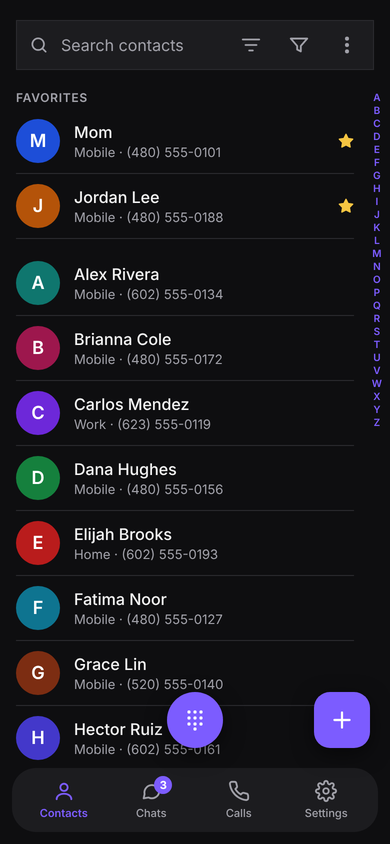
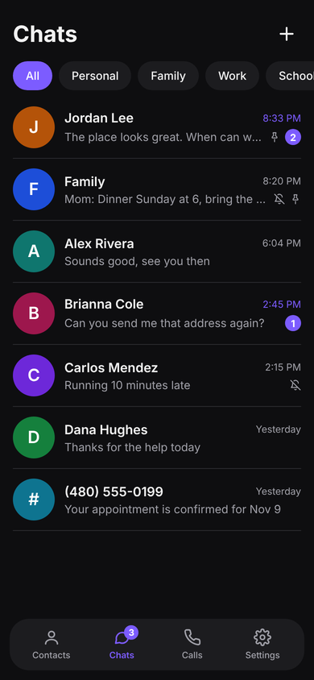
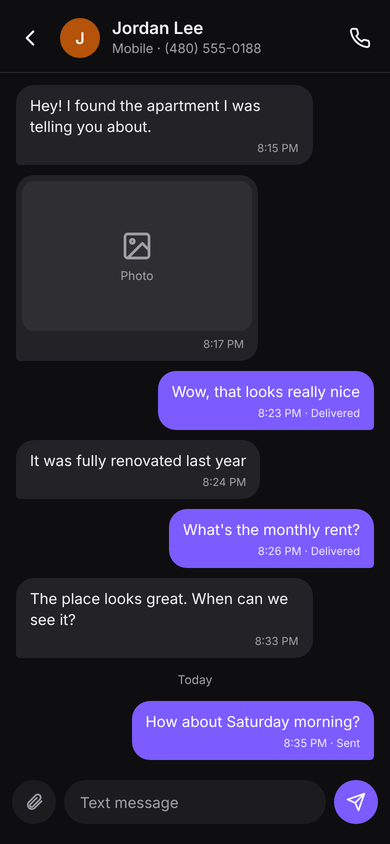
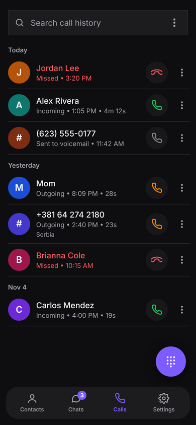
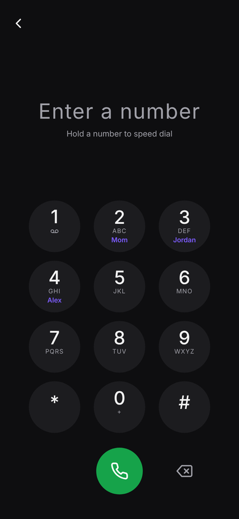
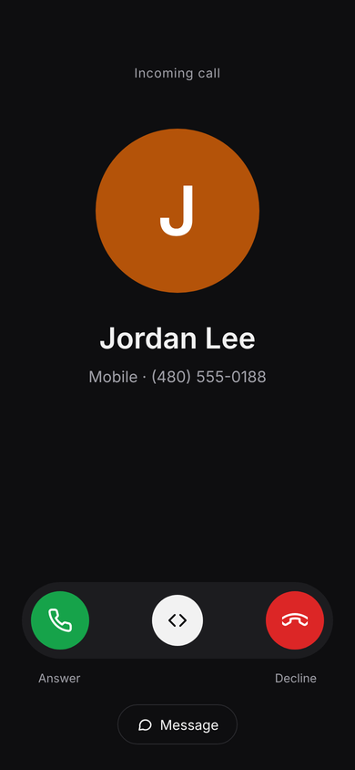
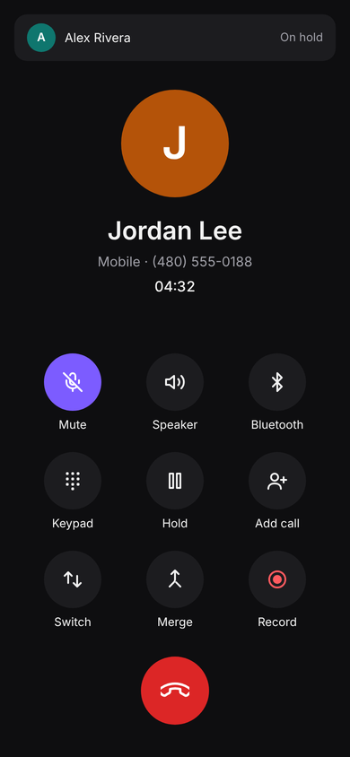
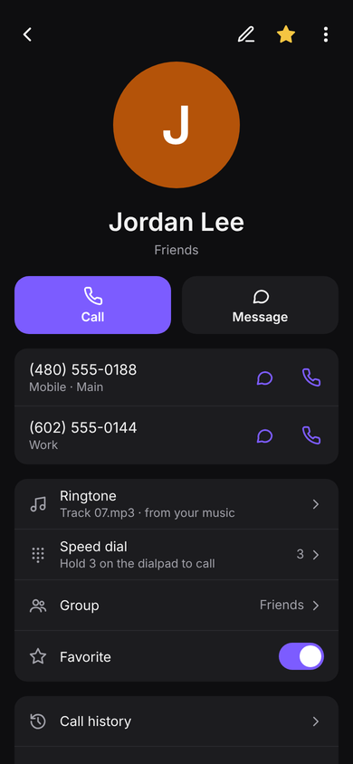
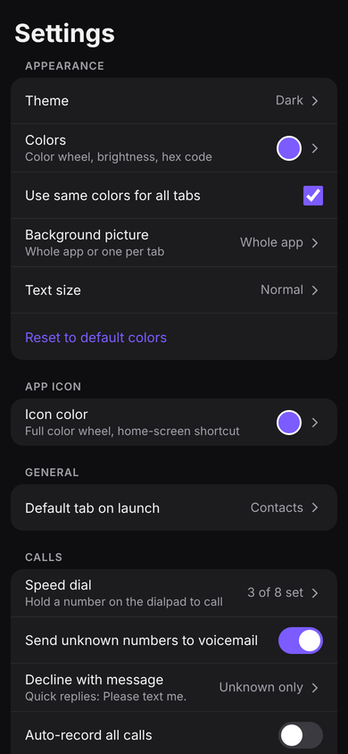
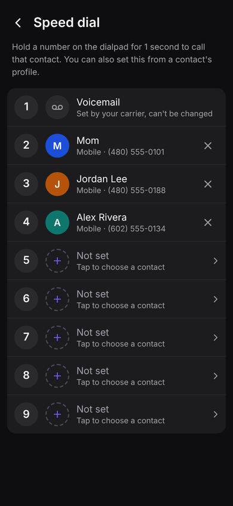

# Communications

An Android-only app for your **contacts, calls and texts**, fully offline and private.

- **No internet permission.** Android itself blocks the app from going online.
- **No ads, tracking, analytics or accounts.**
- **Your contacts stay on your phone**, in the app's private storage. Nothing syncs to the cloud.

## Screens

These are design previews. The finished app follows this look.

<table>
  <tr>
    <td></td>
    <td></td>
    <td></td>
    <td></td>
    <td></td>
  </tr>
  <tr>
    <td align="center">Contacts</td><td align="center">Chats</td><td align="center">Conversation</td><td align="center">Calls</td><td align="center">Dialpad</td>
  </tr>
  <tr>
    <td></td>
    <td></td>
    <td></td>
    <td></td>
    <td></td>
  </tr>
  <tr>
    <td align="center">Incoming call</td><td align="center">In call</td><td align="center">Contact profile</td><td align="center">Settings</td><td align="center">Speed dial</td>
  </tr>
</table>

## Features

| Tab | What it does |
| --- | --- |
| **Contacts** | Pictures, several numbers each, favorites at the top, groups, A–Z bar, a ringtone from your own music, speed dial |
| **Chats** | Texts and picture messages, chat bubbles over other apps, a wallpaper for each conversation |
| **Calls** | Call history with clear colors, dialpad, speed dial, conference calls, call recording, blocking, unknown callers to voicemail |
| **Settings** | Themes, a color wheel, background pictures, app icon color, backup with a reminder every 2 weeks |

## Progress

- [x] **Stage 1:** app skeleton, tab bar, Contacts
- [x] **Stage 2:** Calls (becomes your phone app)
- [ ] **Stage 3:** Chats (becomes your texting app)
- [ ] **Stage 4:** Settings and backup

## Download and install

Communications runs on Android phones only (Android 10 or newer).

1. On your phone, open the [latest release](https://github.com/Blackout-78/Communications/releases/latest).
2. Tap the file that ends in **.apk** to download it.
3. Open the downloaded file.
4. If your phone asks, allow your browser to **install unknown apps**.
5. Tap **Install**.

New builds install over the old one and keep your contacts. GitHub builds a new APK automatically whenever the code changes.

## License

[MIT](LICENSE). Free to use, change and share.
